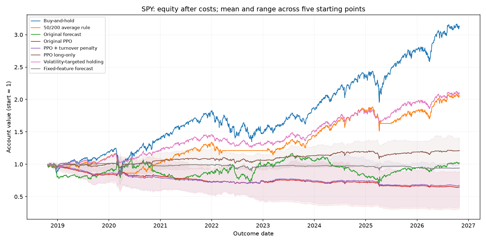

# walk-forward-rl-trading

This project tests trading rules on SPY and QQQ, two traded funds, and Bitcoin.
PPO (Proximal Policy Optimization) learns actions from numerical rewards.
It learns from earlier prices and is evaluated on later dates after trading
expenses. Original PPO lost to buy-and-hold, meaning buying and staying invested,
on all three assets. None of four fixed follow-up changes beat buy-and-hold's
average yearly return. Sharpe measures average return relative to variability;
higher is generally better. The follow-up reused inspected dates, so it does not
establish future performance.

## Compact comparison

Yearly return is compounded growth after expenses; ± is the spread across five
repeatable random starting points. “Best follow-up” means the highest mean Sharpe
among the four pre-declared changes, selected here for description rather than
as new evidence of skill. The full comparison remains below.

| Asset | Strategy | Yearly return after costs | Sharpe |
| --- | --- | --- | --- |
| SPY | Buy-and-hold | 15.30% ± 0.00% | 0.864 ± 0.000 |
| SPY | Original PPO | -5.89% ± 4.73% | -0.431 ± 0.392 |
| SPY | Best follow-up: hold less as prices vary more | 9.69% ± 0.00% | 0.939 ± 0.000 |
| QQQ | Buy-and-hold | 20.03% ± 0.00% | 0.896 ± 0.000 |
| QQQ | Original PPO | -9.88% ± 1.47% | -0.571 ± 0.072 |
| QQQ | Best follow-up: hold less as prices vary more | 11.11% ± 0.00% | 1.020 ± 0.000 |
| BTC-USD | Buy-and-hold | 37.16% ± 0.00% | 0.826 ± 0.000 |
| BTC-USD | Original PPO | -10.25% ± 9.42% | -0.035 ± 0.229 |
| BTC-USD | Best follow-up: hold less as prices vary more | 9.10% ± 0.00% | 0.754 ± 0.000 |

Start with [START_HERE](docs/START_HERE.md), a short beginner guide.
[EXPLAINED](docs/EXPLAINED.md) follows one trade through the code.

## What the evidence says

Original PPO (Proximal Policy Optimization, learning actions from numerical
rewards) lost to buy-and-hold on all three assets after costs. A follow-up froze
four variants before fitting: penalize trading, forbid bets on falling prices,
reduce a holding rule's exposure when prices vary more, and use a fixed forecasting
candidate. **None beat buy-and-hold's average yearly return after costs.**
The risk-sizing rule had higher Sharpe on SPY and QQQ while earning less; Sharpe
means average return relative to variability. All outcomes, including the worse
forecasting candidate, remain recorded.

The follow-up reused previously inspected dates. It is an exploratory comparison,
not a new untouched test or proof of future performance. The plan was committed
at `2e505ef` and the tested training implementation at
`3e3f1c7` before fitting; no settings changed during the run.

## Full results after costs

Yearly return is compounded account growth expressed per year, after fees and
slippage (worse fills than the assumed price). A seed is a repeatable random
starting point; ± is sample standard deviation, the spread across five seeds,
not confidence about future markets. Identical deterministic rules have zero
seed spread by construction. All paths use 2,016 held-return periods, with
decisions from 2018-10-19 through 2026-10-28 and final outcome on 2026-10-29.

| Asset | Strategy | Yearly net return | Sharpe |
| --- | --- | --- | --- |
| BTC-USD | Buy-and-hold | 37.16% ± 0.00% | 0.826 ± 0.000 |
| BTC-USD | Fixed-feature forecast | 7.54% ± 0.00% | 0.598 ± 0.000 |
| BTC-USD | Original forecast | 24.78% ± 0.00% | 0.664 ± 0.000 |
| BTC-USD | 50/200 average rule | 32.27% ± 0.00% | 0.834 ± 0.000 |
| BTC-USD | Original PPO | -10.25% ± 9.42% | -0.035 ± 0.229 |
| BTC-USD | PPO long-only | 6.76% ± 7.09% | 0.358 ± 0.222 |
| BTC-USD | PPO + turnover penalty | -9.15% ± 8.79% | -0.003 ± 0.211 |
| BTC-USD | Volatility-targeted holding | 9.10% ± 0.00% | 0.754 ± 0.000 |
| QQQ | Buy-and-hold | 20.03% ± 0.00% | 0.896 ± 0.000 |
| QQQ | Fixed-feature forecast | -2.23% ± 0.00% | -0.206 ± 0.000 |
| QQQ | Original forecast | 6.40% ± 0.00% | 0.382 ± 0.000 |
| QQQ | 50/200 average rule | 17.44% ± 0.00% | 0.901 ± 0.000 |
| QQQ | Original PPO | -9.88% ± 1.47% | -0.571 ± 0.072 |
| QQQ | PPO long-only | 0.11% ± 0.98% | 0.069 ± 0.082 |
| QQQ | PPO + turnover penalty | -9.76% ± 1.42% | -0.550 ± 0.076 |
| QQQ | Volatility-targeted holding | 11.11% ± 0.00% | 1.020 ± 0.000 |
| SPY | Buy-and-hold | 15.30% ± 0.00% | 0.864 ± 0.000 |
| SPY | Fixed-feature forecast | -0.75% ± 0.00% | -0.041 ± 0.000 |
| SPY | Original forecast | 0.23% ± 0.00% | 0.105 ± 0.000 |
| SPY | 50/200 average rule | 9.42% ± 0.00% | 0.662 ± 0.000 |
| SPY | Original PPO | -5.89% ± 4.73% | -0.431 ± 0.392 |
| SPY | PPO long-only | 2.34% ± 1.79% | 0.326 ± 0.207 |
| SPY | PPO + turnover penalty | -5.49% ± 4.80% | -0.386 ± 0.396 |
| SPY | Volatility-targeted holding | 9.69% ± 0.00% | 0.939 ± 0.000 |

All six metrics and seed rows: [metrics.csv](results/improvement_round/round_001/metrics.csv),
[metrics_by_seed.csv](results/improvement_round/round_001/metrics_by_seed.csv).
Read the [eight-sentence interpretation](docs/IMPROVEMENT_RESULTS.md),
[original gross/net diagnostic](results/diagnostics/run_001/report.md), and
[shuffled-answer/random-agent checks](results/checks/report.md).



An equity curve tracks account value after repeatedly applying returns. Lines
above show the mean of seed paths; shading shows their full range, not a traded
combined strategy. Separate [QQQ](results/improvement_round/round_001/QQQ_equity.png) and
[BTC](results/improvement_round/round_001/BTC-USD_equity.png) curves and all drawdown plots are saved
alongside the metrics. Drawdown means a fall from a previous account-value peak.

## How evaluation works

Completed earlier bars become features (numerical inputs). They are delayed one
session; an opening position earns the following open-to-open return. Training
uses rolling three-year windows and testing uses the following up-to-six months,
for 17 windows per asset. Purging removes training answers ending at or after the
next test boundary. Scalers (input normalization) and models fit training rows only.
PPO uses a 20-session observation window plus current position and a bounded
continuous exposure. Real one-way fees are 5 basis points plus 2 slippage, where a
basis point is 0.01%; reversing from −1 to +1 pays twice the 7-bp rate. Exposure
persists across windows and a final exit is charged. Reward-only penalties are
never deducted a second time from investment returns. Each PPO fit requests
10,000 steps and collects 10,240 to finish 256-step batches.

## Install and inspect without training

```bash
python3.11 -m venv .venv
source .venv/bin/activate
python -m pip install -r requirements-lock.txt
python -m pytest -q
python -m src.result_archive --source results/final
python -m src.result_archive --source results/improvement_round/round_001
python -m src.improvement_report
```

The verified environment is Python 3.11 on macOS CPU. `requirements-lock.txt`
records its exact packages; `requirements.txt` is the broader dependency
specification for other environments. Other operating systems were not validated.
Small, checksummed result archives restore excluded daily result CSVs without
network access, retraining, deleting, or overwriting existing histories. They
contain saved exposure decisions and realized returns, not downloaded price bars
or model weights. The suite currently has **36 passing tests**. Archived
audit files keep the test counts recorded at their original runs.

## Credentials

The current public yfinance pipeline needs no API keys. `.env` is a local text
file for any future credentials; it is ignored by Git and restricted to its owner
on this machine. `.env.example` contains comments and an empty placeholder only.
Never put credentials in `config.yaml`, source code, notebooks, or result files.
Future authenticated integrations should read credentials from environment
variables; this pipeline currently does not load `.env` automatically. A `.env`
file is not encryption, and leaked credentials must be revoked rather than merely
moved out of a file. GitHub access should use a credential manager or SSH agent,
not a token embedded in a remote URL or project file.

## Run a new experiment without overwriting history

The original entry point is `python -m src.run_all`. For repetitions, first give
`results_dir` a fresh directory because the historical entry point uses fixed mode
subdirectories. Public yfinance downloads need network access; no API keys are used.

For an identical replication of the declared follow-up, restore original histories
as above, set only `improvement_round.id` and `improvement_round.output` to a fresh
name/path, update the plan identifier, and commit those changes. Keep all numerical
settings fixed; a changed hypothesis needs a separate declared round. Then run:

```bash
python -m src.improvement_round
python -m src.improvement_report
```

The completed `round_001` refuses another fit or overwrite. Only an interrupted
identical round accepts `python -m src.improvement_round --resume`; its committed
source, configuration, data, and package versions must match. All four variants
are evaluated once with five seeds. This round took **24.1 minutes** for 510 new
PPO fits plus 255 forecast fits. Snapshots, commit IDs, seed metrics, daily paths,
and the append-only event record preserve every outcome and failure. Original
results under `results/final/` stay unchanged. Price revisions in a later download
can cause the matching-price audit to reject a replication; the original local
price cache is preserved but excluded from Git.

## Limitations

- **Reused tests:** follow-up ideas were requested after seeing earlier results;
  pre-declaration prevents additional searching within the round but cannot undo
  that prior inspection. New untouched history is needed for stronger claims.
- **Data availability:** adjusted vendor prices can be revised; today's surviving
  assets and intersected missing-date calendars can carry retrospective selection.
  Past-only code does not prove point-in-time vendor data or an unbiased universe.
- **Execution:** adjusted-open fills, constant slippage, zero computation delay,
  and target-change turnover simplify real trading. Price-drift rebalancing,
  financing, borrowing availability, taxes, partial fills, and market impact
  (orders moving prices) are omitted. Continuous crypto trading leaves little
  buffer between adjacent daily bars; actual delayed fills were not tested.
- **Comparisons:** a 10% volatility target roughly controls risk, rather than exactly
  matching PPO. Higher Sharpe with lower return is a trade-off, not superiority on
  every measure. Long-only gains can reflect a rising market rather than timing.
- **Diagnostics:** scrambled answers preserve their average and distort the
  feature/reward relationship; zero test return is not guaranteed. Their 1,024-step
  training budget differs from the full run. Random agents match test positions
  retrospectively; their ranks are descriptive, not formal evidence of skill.
- **Uncertainty:** seeds share one market history. Their spread is not a future
  confidence interval, and identical-rule zero spread is structural. The reward
  uses some recent history absent from the observation. The forecast changes
  multiple declared model/position choices together, so causation is unresolved.
- **No deployment claim:** no live trading, market capacity, or future profitability
  was established. Cached prices, large histories, checkpoints, local logs,
  environment files, and credentials are excluded from Git; small result archives
  retain inspectable evidence without publishing those files.
