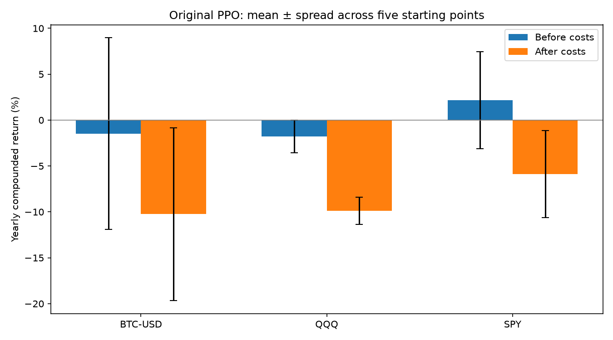

# Results summary: full-budget experiment

## In plain language

We repeatedly learned from earlier three-year windows and tested on the following up-to-six months, using 17 test windows per asset, five random starting points, and a trading charge of 7 basis points (0.07%) per unit of exposure changed.
PPO performed worse than every baseline on every asset by both average annual return after costs and Sharpe, which measures average return relative to its variability.
The numbers of PPO runs with positive annual returns were BTC-USD: 1 of 5; QQQ: 0 of 5; SPY: 0 of 5, so losses were consistent across starting points for SPY and QQQ.
The ± values measure variation across starting points rather than uncertainty about future markets, while the simple rules have zero variation because they are repeated unchanged.
Keeping decisions fixed, increasing fees plus slippage from zero to 20 basis points worsened PPO's average Sharpe on all three assets, and even free trading left it behind buy-and-hold on this measure.
At the separate, equal 1,024-step training budget, scrambling the training answers barely changed PPO's results, providing little evidence that it learned useful daily return timing at that budget.
The 1,000 random-agent comparisons per asset showed that a PPO starting point could rank well against luck while still losing money, so one favorable rank does not establish reliable skill.
We did not tune using these test results, and revised data, asset selection, simplified trading assumptions, and future market changes still limit the conclusion.

## Results table

Net means after fees and slippage; bps means basis points, each equal to 0.01%.
Mean is the average across five seeds (repeatable random starting states), and
standard deviation after ± measures their spread. Volatility measures how variable
returns are; Sharpe divides average return by that variability and scales to a
year; max drawdown is the worst fall from a previous wealth peak; turnover measures
position changes; hit rate counts profitable exposed periods. Daily turnover is a
fraction of account exposure, so 1.0 means 100% of account value changed hands.

| Asset | Strategy | Annual net return | Annual volatility | Sharpe | Max drawdown | Daily turnover | Hit rate |
| --- | --- | --- | --- | --- | --- | --- | --- |
| BTC-USD | buy_hold | 37.16% ± 0.00% | 60.96% ± 0.00% | 0.83 ± 0.00 | -76.64% ± 0.00% | 0.0010 ± 0.0000 | 49.85% ± 0.00% |
| BTC-USD | gradient_boosting | 24.78% ± 0.00% | 60.96% ± 0.00% | 0.66 ± 0.00 | -77.74% ± 0.00% | 0.3760 ± 0.0000 | 49.90% ± 0.00% |
| BTC-USD | ma_50_200 | 32.27% ± 0.00% | 46.23% ± 0.00% | 0.83 ± 0.00 | -60.57% ± 0.00% | 0.0050 ± 0.0000 | 50.28% ± 0.00% |
| BTC-USD | ppo | -10.25% ± 9.42% | 43.52% ± 1.45% | -0.03 ± 0.23 | -84.49% ± 6.92% | 0.5277 ± 0.0200 | 48.22% ± 1.07% |
| QQQ | buy_hold | 20.03% ± 0.00% | 23.47% ± 0.00% | 0.90 ± 0.00 | -36.69% ± 0.00% | 0.0010 ± 0.0000 | 55.75% ± 0.00% |
| QQQ | gradient_boosting | 6.40% ± 0.00% | 23.52% ± 0.00% | 0.38 ± 0.00 | -44.51% ± 0.00% | 0.2768 ± 0.0000 | 52.58% ± 0.00% |
| QQQ | ma_50_200 | 17.44% ± 0.00% | 20.09% ± 0.00% | 0.90 ± 0.00 | -27.56% ± 0.00% | 0.0050 ± 0.0000 | 56.69% ± 0.00% |
| QQQ | ppo | -9.88% ± 1.47% | 15.95% ± 0.79% | -0.57 ± 0.07 | -61.29% ± 7.47% | 0.4878 ± 0.0206 | 45.69% ± 1.07% |
| SPY | buy_hold | 15.30% ± 0.00% | 18.46% ± 0.00% | 0.86 ± 0.00 | -32.05% ± 0.00% | 0.0010 ± 0.0000 | 55.85% ± 0.00% |
| SPY | gradient_boosting | 0.23% ± 0.00% | 18.49% ± 0.00% | 0.11 ± 0.00 | -39.18% ± 0.00% | 0.3085 ± 0.0000 | 51.69% ± 0.00% |
| SPY | ma_50_200 | 9.42% ± 0.00% | 15.40% ± 0.00% | 0.66 ± 0.00 | -32.05% ± 0.00% | 0.0050 ± 0.0000 | 56.20% ± 0.00% |
| SPY | ppo | -5.89% ± 4.73% | 12.35% ± 0.49% | -0.43 ± 0.39 | -45.20% ± 16.35% | 0.4651 ± 0.0188 | 45.26% ± 2.04% |

Buy-and-hold, moving-average crossover, and gradient boosting keep their original
fixed settings. They are repeated identically for all five seed rows to make the
table rectangular; their zero seed std is structural and does not imply certainty
about markets. PPO seed metrics are calculated separately before their mean/std.

## What the checks added

| Asset | Full PPO Sharpe: 0 → 20 bps | 1,024-step PPO Sharpe: ordinary → shuffled | Full PPO random percentile range |
| --- | --- | --- | --- |
| BTC-USD | 0.18 → -0.43 | -0.18 → -0.17 | 46.0–95.2 |
| QQQ | -0.03 → -1.57 | -0.26 → -0.24 | 41.9–62.4 |
| SPY | 0.23 → -1.66 | -0.53 → -0.53 | 20.5–98.0 |

All-in cost includes both fees and slippage. The random percentiles show the range
across the five PPO seeds; a higher percentile does not mean a probability of future
success. Shuffling was tested at a smaller, explicitly matched training budget.
A near-zero Sharpe does not imply zero compounded annual return: gaining 10% and
then losing 10% leaves only 99% of starting wealth. This distinction helps explain
BTC-USD's negative annual growth despite an average PPO Sharpe close to zero.

## Reproduce and inspect

The data end is pinned to `2026-10-30` (exclusive) using the original
cached downloads. `results/final/config.json`, `manifest.json`, and `folds.csv`
record settings, versions, signatures, and boundaries. `metrics.csv` contains
mean/std for all six metrics; `metrics_by_seed.csv` retains every run.
Test decisions ran from 2018-10-19 through
2026-10-28, with the last return realized at
2026-10-29; earlier history supplies training and feature warmup.
Each PPO fit requested 10,000 learning steps;
the library completes its 256-step chunks, collecting
10,240 training steps per fit.
The measured training-and-main-output runtime was 11.1
minutes, below the conservative 21.3-minute pre-run estimate and 30-minute threshold.
`*_oos.csv` gives daily decisions, realized returns, costs, and final liquidation.
Equity curves track compounded account value; drawdown plots track losses from
previous peaks. `*_cost_sensitivity.png` reprices identical positions at 0/5/7/20
bps total cost, including slippage, without retraining policies for each cost.
See `results/checks/report.md` for the paired shuffled-label experiment and its
lower training budget; `results/checks/final_random_policy/` compares the full
agent against random positions calibrated retrospectively to its activity.

## Limitations that matter for this conclusion

- The five seeds reuse the same market history; they are not five independent
  economic experiments or a confidence interval for future profitability.
- Shuffling training returns preserves their mean and can reward market direction;
  it also breaks serial order and the consistency between lagged features and
  simulated reward history. Five permutations per fold are an artificial
  diagnostic, not a formal statistical test or alternate realistic market.
- Cost plots hold positions fixed and do not model how an agent retrained at a
  different cost might behave. Constant slippage can understate difficult execution.
- Random policies match average exposure and turnover, using test positions for
  descriptive calibration; they do not match all PPO behavior or constitute a
  strategy available before the test. Their percentiles are not statistical p-values.
- Adjusted vendor history, surviving asset selection, and common-date alignment
  can carry retrospective information even though code-level timing is causal.
- Rebalancing from price drift, borrowing/funding, liquidity, taxes, execution
  delays, and market impact are omitted. The observation omits some reward history.
- All test periods have now been inspected. Any further change motivated by these
  results requires new untouched data or nested validation, meaning separate
  earlier data used for model choices before a final untouched evaluation.

## Original PPO diagnostic: run_001

**Annualized return** means compounded growth expressed per year; **gross** is
before costs and **net** is after costs. **Turnover** is the absolute change in
target position: 0.5 means changing half an account's target exposure per day.
**Average absolute position** measures exposure size, ignoring direction. **Long**
benefits from rising prices, **short** benefits from falling prices, and **flat**
means a position within 0.00000001 of zero. Values are averages across five seeds
(repeatable random starting points); ± is their sample standard deviation, a
measure of variation. All six original performance metrics remain in `results/final/`.
Entry, direction reversal, fold carry, and final exit costs are included.

| Asset | Before costs, yearly | After costs, yearly | Daily turnover | Average absolute position | Long | Short | Flat |
| --- | --- | --- | --- | --- | --- | --- | --- |
| BTC-USD | -1.48% ± 10.44% | -10.25% ± 9.42% | 0.528 | 0.636 | 53.7% | 46.3% | 0.0% |
| QQQ | -1.77% ± 1.79% | -9.88% ± 1.47% | 0.488 | 0.597 | 55.1% | 44.9% | 0.0% |
| SPY | 2.17% ± 5.28% | -5.89% ± 4.73% | 0.465 | 0.580 | 51.2% | 48.8% | 0.0% |

## Five-sentence explanation

Before costs, PPO's average yearly compounded returns were BTC-USD -1.48%; QQQ -1.77%; SPY 2.17%.
After costs, they were BTC-USD -10.25%; QQQ -9.88%; SPY -5.89%.
Average daily turnover was BTC-USD 0.528; QQQ 0.488; SPY 0.465, so the agent changed roughly half an account's target exposure each day.
A positive before-cost return alone does not establish a prediction signal, meaning information that reliably helps choose profitable future trades, because market direction and luck also affect returns.
Trading expenses explain a substantial part of the loss, but weak before-cost performance relative to buy-and-hold also matters, so trading less alone is not proven to solve the problem.

<!-- IMPROVEMENT_ROUND_001 -->

## Pre-declared improvement round: all outcomes

A **seed** is a repeatable random starting point. **Net return** is growth after
fees and slippage (worse execution prices). **Annualized** means expressed on a
one-year compounded scale. **Volatility** is return variability. **Sharpe** divides
average return by variability and scales to a year. **Drawdown** is a fall from a
previous wealth peak. **Turnover** is the change in target exposure each day; 1.0
means an account's full target exposure changed. **Hit rate** is the fraction of
exposed periods with positive net return. Values following ± are sample standard
deviations: spread across seeds, not confidence about future markets.

## Eight-sentence interpretation

None of the four new variants beat buy-and-hold's average yearly return after costs on any asset.
Of the 12 asset/variant comparisons, 0 exceeded buy-and-hold on both average return and Sharpe, a measure of return relative to variability.
The turnover penalty reduced average daily trading on 3 of 3 assets and improved average return over original PPO on 3 of 3.
The long-only agent improved average return over original PPO on 3 of 3 assets, but buying a historically rising market does not itself show predictive timing.
The volatility-targeted holding rule lowered measured variability on 3 of 3 assets and improved Sharpe on 2 of 3, while earning less, so its benefit is a risk comparison rather than higher absolute return.
The fixed-feature forecast improved average return over the original forecasting rule on 0 of 3 assets, which evaluates the combined fixed model and position rule rather than proving the inputs caused an improvement.
The five seeds show variation from random starting points, while identical rule-based decisions have zero seed spread and neither measures uncertainty across future markets.
Every variant was kept with its declared settings, but these reused test dates make this exploratory evidence that still needs new untouched history before claiming a lasting improvement.

## All strategies, after costs

| Asset | Strategy | Yearly net return | Yearly volatility | Sharpe | Worst drawdown | Daily turnover | Hit rate |
| --- | --- | --- | --- | --- | --- | --- | --- |
| BTC-USD | Buy-and-hold | 37.16% ± 0.00% | 60.96% ± 0.00% | 0.826 ± 0.000 | -76.64% ± 0.00% | 0.001 ± 0.000 | 49.85% ± 0.00% |
| BTC-USD | Fixed-feature forecast | 7.54% ± 0.00% | 13.73% ± 0.00% | 0.598 ± 0.000 | -20.37% ± 0.00% | 0.120 ± 0.000 | 48.21% ± 0.00% |
| BTC-USD | Original forecast | 24.78% ± 0.00% | 60.96% ± 0.00% | 0.664 ± 0.000 | -77.74% ± 0.00% | 0.376 ± 0.000 | 49.90% ± 0.00% |
| BTC-USD | 50/200 average rule | 32.27% ± 0.00% | 46.23% ± 0.00% | 0.834 ± 0.000 | -60.57% ± 0.00% | 0.005 ± 0.000 | 50.28% ± 0.00% |
| BTC-USD | Original PPO | -10.25% ± 9.42% | 43.52% ± 1.45% | -0.035 ± 0.229 | -84.49% ± 6.92% | 0.528 ± 0.020 | 48.22% ± 1.07% |
| BTC-USD | PPO long-only | 6.76% ± 7.09% | 32.68% ± 2.43% | 0.358 ± 0.222 | -61.17% ± 10.35% | 0.249 ± 0.029 | 49.29% ± 0.64% |
| BTC-USD | PPO + turnover penalty | -9.15% ± 8.79% | 43.74% ± 1.62% | -0.003 ± 0.211 | -84.65% ± 6.78% | 0.502 ± 0.018 | 48.53% ± 0.96% |
| BTC-USD | Volatility-targeted holding | 9.10% ± 0.00% | 12.61% ± 0.00% | 0.754 ± 0.000 | -20.54% ± 0.00% | 0.011 ± 0.000 | 49.85% ± 0.00% |
| QQQ | Buy-and-hold | 20.03% ± 0.00% | 23.47% ± 0.00% | 0.896 ± 0.000 | -36.69% ± 0.00% | 0.001 ± 0.000 | 55.75% ± 0.00% |
| QQQ | Fixed-feature forecast | -2.23% ± 0.00% | 9.01% ± 0.00% | -0.206 ± 0.000 | -23.49% ± 0.00% | 0.147 ± 0.000 | 48.16% ± 0.00% |
| QQQ | Original forecast | 6.40% ± 0.00% | 23.52% ± 0.00% | 0.382 ± 0.000 | -44.51% ± 0.00% | 0.277 ± 0.000 | 52.58% ± 0.00% |
| QQQ | 50/200 average rule | 17.44% ± 0.00% | 20.09% ± 0.00% | 0.901 ± 0.000 | -27.56% ± 0.00% | 0.005 ± 0.000 | 56.69% ± 0.00% |
| QQQ | Original PPO | -9.88% ± 1.47% | 15.95% ± 0.79% | -0.571 ± 0.072 | -61.29% ± 7.47% | 0.488 ± 0.021 | 45.69% ± 1.07% |
| QQQ | PPO long-only | 0.11% ± 0.98% | 11.63% ± 1.34% | 0.069 ± 0.082 | -30.13% ± 5.80% | 0.252 ± 0.017 | 53.02% ± 0.65% |
| QQQ | PPO + turnover penalty | -9.76% ± 1.42% | 16.24% ± 0.85% | -0.550 ± 0.076 | -60.79% ± 7.82% | 0.457 ± 0.017 | 46.37% ± 0.81% |
| QQQ | Volatility-targeted holding | 11.11% ± 0.00% | 10.92% ± 0.00% | 1.020 ± 0.000 | -15.92% ± 0.00% | 0.020 ± 0.000 | 55.70% ± 0.00% |
| SPY | Buy-and-hold | 15.30% ± 0.00% | 18.46% ± 0.00% | 0.864 ± 0.000 | -32.05% ± 0.00% | 0.001 ± 0.000 | 55.85% ± 0.00% |
| SPY | Fixed-feature forecast | -0.75% ± 0.00% | 8.78% ± 0.00% | -0.041 ± 0.000 | -23.99% ± 0.00% | 0.130 ± 0.000 | 47.52% ± 0.00% |
| SPY | Original forecast | 0.23% ± 0.00% | 18.49% ± 0.00% | 0.105 ± 0.000 | -39.18% ± 0.00% | 0.309 ± 0.000 | 51.69% ± 0.00% |
| SPY | 50/200 average rule | 9.42% ± 0.00% | 15.40% ± 0.00% | 0.662 ± 0.000 | -32.05% ± 0.00% | 0.005 ± 0.000 | 56.20% ± 0.00% |
| SPY | Original PPO | -5.89% ± 4.73% | 12.35% ± 0.49% | -0.431 ± 0.392 | -45.20% ± 16.35% | 0.465 ± 0.019 | 45.26% ± 2.04% |
| SPY | PPO long-only | 2.34% ± 1.79% | 8.62% ± 1.31% | 0.326 ± 0.207 | -19.32% ± 7.61% | 0.218 ± 0.015 | 53.34% ± 1.96% |
| SPY | PPO + turnover penalty | -5.49% ± 4.80% | 12.73% ± 0.31% | -0.386 ± 0.396 | -44.54% ± 17.44% | 0.424 ± 0.021 | 45.30% ± 2.30% |
| SPY | Volatility-targeted holding | 9.69% ± 0.00% | 10.43% ± 0.00% | 0.939 ± 0.000 | -13.99% ± 0.00% | 0.020 ± 0.000 | 55.80% ± 0.00% |

The plan was frozen at commit `2e505ef588a26ee56eed190f04e51ec0c87d7218` and implementation at `3e3f1c7aff661f3245bf12197987ca81fff2b99d` before fitting. Original results are reused from `results/final/`; all new paths and failures stay in `results/improvement_round/round_001/`. This round fitted 510 new PPO seed/window policies and evaluated all four variants on five seeds and 17 windows per asset. No settings were chosen from these outcomes.

## Curves and exposure

Curves display the mean of individual account paths; shading shows the full seed range. They are descriptive averages, not an implemented combined strategy. Drawdowns are calculated separately for each seed before display. `exposure_by_seed.csv` retains before-cost returns, trading activity, exposure sizes, and long/short/flat fractions.

## What remains uncertain

The round follows inspection of earlier test results. Pre-declaration prevents additional searches within the round but does not undo that selection. The volatility target only roughly matches risk; long-only gains can reflect market direction. The forecast changed its loss, tree settings, and position scaling together. Vendor adjustments, survivor selection, shared calendars, price-drift rebalancing, funding, short borrowing, and simplified fills remain limitations. No future-profit or formal significance claim is made.

<!-- END_IMPROVEMENT_ROUND_001 -->
